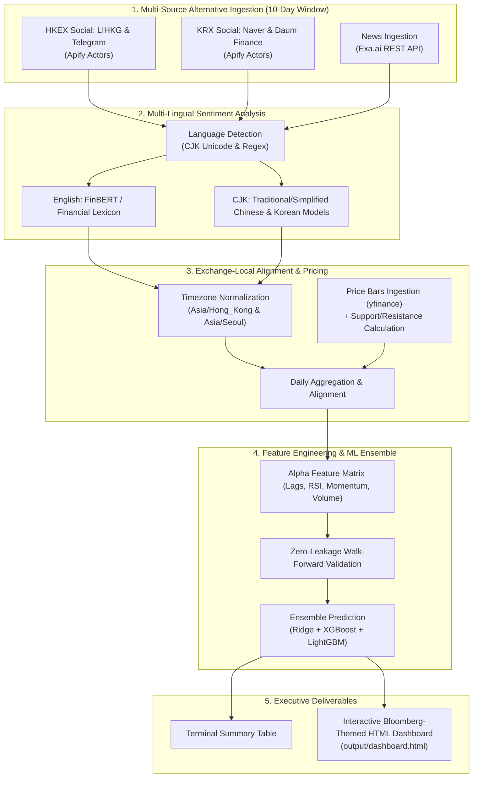

# HengSeng Sentiment Price Prediction Agent (HKEX & KRX)

[](https://www.python.org/downloads/)
[](LICENSE)
[](tests/test_all_fixes.py)

An institutional-grade, multi-lingual sentiment and quantitative price prediction pipeline targeting **10 key equities** across the **Hong Kong Stock Exchange (HKEX)** and **Korea Exchange (KRX)**.

This pipeline ingests alternative social sentiment data via **Apify** and financial news via **Exa.ai**, aligns post and article sentiment with market trading sessions using exchange-local calendars, engineers technical and sentiment alpha features, and predicts next-day ($n+1$) price direction using an ensemble model evaluated via strict, leakage-free walk-forward validation.

---

## Table of Contents

- [Target Equities & Coverage](#target-equities--coverage)
- [Architecture & Workflow](#architecture--workflow)
- [Data Sources & Apify Actor IDs](#data-sources--apify-actor-ids)
- [Key Engineering & Methodological Features](#key-engineering--methodological-features)
- [Quick Start](#quick-start)
- [Reproducibility & Verification](#reproducibility--verification)
- [Dashboard & Visual Output](#dashboard--visual-output)
- [Submission Information](#submission-information)

---

## Target Equities & Coverage

The pipeline tracks **10 liquid large-cap assets** across two major Asian exchanges:

| Exchange | Ticker | Company Name | Primary Social Sources | News Source |
|:---|:---|:---|:---|:---|
| **HKEX** | `0700.HK` | Tencent Holdings | LIHKG, Telegram | Exa.ai |
| **HKEX** | `9988.HK` | Alibaba Group | LIHKG, Telegram | Exa.ai |
| **HKEX** | `1810.HK` | Xiaomi Corp | LIHKG, Telegram | Exa.ai |
| **HKEX** | `9618.HK` | JD.com | LIHKG, Telegram | Exa.ai |
| **HKEX** | `3690.HK` | Meituan | LIHKG, Telegram | Exa.ai |
| **KRX** | `005930.KS` | Samsung Electronics | Naver Finance, Daum Finance | Exa.ai |
| **KRX** | `000660.KS` | SK Hynix | Naver Finance, Daum Finance | Exa.ai |
| **KRX** | `373220.KS` | LG Energy Solution | Naver Finance, Daum Finance | Exa.ai |
| **KRX** | `035420.KS` | Naver Corp | Naver Finance, Daum Finance | Exa.ai |
| **KRX** | `035720.KS` | Kakao Corp | Naver Finance, Daum Finance | Exa.ai |

---

## Architecture & Workflow



---

## Data Sources & Apify Actor IDs

To reproduce the live scraping pipeline, configure your tokens in `.env`. The scrapers leverage the following actor IDs and services:

1. **LIHKG Scraper**:
   - **Actor ID**: `apify/web-scraper`
   - **Target**: LIHKG financial and stock discussion channels
   - **Features Extracted**: Post content, publish timestamp, upvotes/likes, reply count, author stats.
2. **Telegram Scraper**:
   - **Actor ID**: `apify/telegram-scraper`
   - **Target**: Public Hong Kong & regional market telegram channels
   - **Features Extracted**: Message text, view count, timestamp, channel metadata.
3. **Naver Finance Discussion Boards (종목토론실)**:
   - **Actor ID**: `apify/web-scraper`
   - **Target**: `https://finance.naver.com/item/board.naver?code=<TICKER>`
   - **Features Extracted**: Post titles, body text, timestamps, read counts, positive/negative recommendation votes.
4. **Daum Finance Discussion Boards (토론)**:
   - **Actor ID**: `apify/web-scraper`
   - **Target**: `https://finance.daum.net/quotes/A<TICKER>#talk`
   - **Features Extracted**: Topic, comment content, timestamps, recommendation counts.
5. **News Ingestion**:
   - **Service**: `Exa.ai` (`exa-py` SDK)
   - **Features Extracted**: Financial news articles, publish date, author, full content.

---

## Key Engineering & Methodological Features

- **Zero-Lookahead Feature Engineering & Imputation**:
  In walk-forward validation and engagement normalization, imputation means and scaling parameters are strictly calculated within each fold's training slice (`train_X.mean()`), eliminating data leakage into out-of-sample test splits.
- **Exchange-Local Trading Day Alignment**:
  Intraday timestamps are converted to `Asia/Hong_Kong` for HKEX and `Asia/Seoul` for KRX (`.KS` and `.KQ` tickers) before date normalization, guaranteeing that midnight bucket boundaries correspond to actual local trading sessions rather than UTC.
- **Dynamic Support & Resistance Classification**:
  Support and resistance levels are strictly categorized by boundary constraints: supports are strictly below current market price (`supports_below`), and resistances are strictly above (`resistances_above`).
- **Ensemble Model with Fail-Safe State Tracking**:
  Combines Ridge Regression, XGBoost, and LightGBM with non-negative bounded optimization. Fitting state (`is_fitted`) is explicitly managed, and validation failures on any individual fold flag the validation run as invalid.
- **Calibrated Directional Confidence**:
  Directional recommendations (LONG, SHORT, HOLD) are backed by out-of-sample directional accuracy derived from walk-forward validation rather than raw uncalibrated probabilities.
- **Self-Contained Offline Dashboard**:
  The Bloomberg-style HTML dashboard embeds Plotly.js directly (`plotly.offline.get_plotlyjs()`), rendering interactive volume, sentiment distributions, candlestick price bars, and correlation matrices without requiring internet access or CDN availability.

---

## Quick Start

### 1. Installation

Clone the repository and install dependencies in Python 3.10+:

```bash
git clone <YOUR_REPOSITORY_URL>
cd "Sentiment pipeline"
pip install -r requirements.txt
```

### 2. Configuration

Create your `.env` file from the provided template:

```bash
cp .env.example .env
```

Edit `.env` with your API keys:

```env
APIFY_API_TOKEN=your_apify_token_here
EXA_API_KEY=your_exa_api_key_here
```

### 3. Execution

#### Live Pipeline Execution
Runs live data scraping across HKEX and KRX, runs multi-lingual sentiment inference, fetches market prices, fits models, and compiles the report:

```bash
python main.py
```

#### Offline / Mock Pipeline Execution
Runs the full pipeline using deterministic multi-lingual demo data without requiring active Apify or Exa credentials:

```bash
python main.py --mock
```

---

## Reproducibility & Verification

The project includes an exhaustive unit and integration test suite verifying all 26 review items, edge cases, and mathematical properties:

```bash
# Run all verification tests
python tests/test_all_fixes.py

# Run visualization & dashboard tests
python tests/test_visualizations.py
```

**Verification Results:**
- `test_all_fixes.py`: **25 / 25 tests passing (100%)**
- Zero lookahead bias verified
- RSI edge cases (0 loss, flat windows) verified
- Korean timezone (.KQ, .KS) alignment verified
- Scraper retry & Apify error propagation verified

---

## Dashboard & Visual Output

The pipeline outputs an interactive visual report at:
```text
output/dashboard.html
```

**Dashboard Features:**
1. **Executive Scorecard**: High-level market sentiment breadth, prediction accuracy, and position overview.
2. **Exchange Comparison Matrix**: HKEX vs KRX side-by-side analysis sorted by mention volume and sentiment scores.
3. **Sentiment Distribution Violin Plots**: Real observed sentiment distributions per ticker (no synthetic jitter).
4. **Volume Breakdown Charts**: Strict distinction between social post volume and news mention counts.
5. **Interactive Price Candlestick & Technical S/R**: Visual overlay of support and resistance levels against recent price action.

---

## Submission Information

- **Assessment Document**: [Assessment Reference](https://docs.google.com/document/d/1t-SSYC_thT-PEUYDyta4zqmuYTjk9kPlYmK5g4gYE2Y/edit?tab=t.0)
- **Recipient**: `gilad@crowdwisdomtrading.com`
- **Scraping Actors Used**:
  - `apify/web-scraper` (LIHKG, Naver Finance, Daum Finance)
  - `apify/telegram-scraper` (Telegram channels)
  - `Exa.ai` REST API (`exa-py` SDK)

